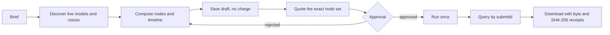

# Dreamina Canvas

## Plugin marketplaces

This plugin belongs to **AIGC content creation**.

| Category | Marketplace | Purpose |
| --- | --- | --- |
| Full-stack development | [Full Stack Plugins](https://github.com/partme-ai/full-stack-plugins) | Architecture and UI design, code understanding, quality checks, code review, workflow governance, and server operations |
| AIGC content creation | [Full AIGC Plugins](https://github.com/partme-ai/full-aigc-plugins) | Image, video, audio, music, 3D, and multimodal content creation |


> Build Dreamina canvases from typed nodes and a timeline, keep the free save step separate from the quoted run, and download assets with byte counts and SHA-256 receipts.

[](https://github.com/full-aigc-plugins/dreamina-canvas-plugin/releases) [](#skills) [](LICENSE)

[English](README.md) | [简体中文](README.zh-CN.md) · [Install](#installation) · [Quick start](#quick-start) · [Skills](#skills) · [Architecture](docs/Dreamina-Canvas-Plugin-Architecture.md) · [Troubleshooting](#troubleshooting)

## Positioning

`dreamina-canvas` turns a brief into a structured Dreamina canvas: typed nodes, a timeline, capability discovery at run time, a free draft save, then a quoted run that only executes after you approve it. The plugin never hard-codes catalog values, never merges the save step with the run step, and never mints a replacement `submitId` to recover from a timeout.

It is a strict wrapper around the installed `dreamina-canvas` CLI and ships no MCP server: the eleven Skills drive the CLI through an argv-only adapter. Authentication and canvas state stay with the CLI; the plugin persists only non-secret operation identifiers.

The [historical real-environment acceptance](docs/verification/real-environment-acceptance-2026-09-13.md) records PASS for its listed CLI workflows. Current Windows and paid visual-loop verification were not rerun. The [add-canvas-visual-quality-loop change](openspec/changes/archive/2026-09-22-add-canvas-visual-quality-loop/proposal.md) documents the single-round local regression and remaining multi-round scope.

## Installation

### Prerequisites

- Python 3.11 or newer on `PATH`.
- The `dreamina-canvas` CLI, installed and authenticated before first use. The setup and auth Skills can run the official installer and login, but only after explicit authorization, and the binary is never bundled.
- Visual-loop runtime dependency: `jsonschema` from `requirements.txt`. Install with `python -m pip install -r requirements.txt`.
- Development and test gates additionally use `requirements-dev.txt`.

### From the plugin marketplace

```bash
codex plugin marketplace add partme-ai/full-aigc-plugins
codex plugin add dreamina-canvas@full-aigc-plugins
```

Restart the host and open a new task so the Skills load. Then verify the packaged Skills still match the upstream lock file:

```bash
python scripts/verify_dreamina_canvas_skills.py
```

## Quick start



```text
Create a Dreamina canvas for a 15-second product teaser. Draft the nodes and
do not run anything yet.
```

Expected observation: live capabilities are discovered, typed nodes are composed, a draft is saved, and the plugin confirms that nothing was charged. Ask for a quote next; the run happens once, after you approve the credit total.

## What you can build

| Workflow | Built-in path | Verifiable output |
| --- | --- | --- |
| Image nodes | `dreamina-canvas-cli-text2image`, `dreamina-canvas-cli-image2image` | Saved draft, quoted run, verified image assets |
| Video nodes | `dreamina-canvas-cli-text2video`, `dreamina-canvas-cli-ref2video` | First/last-frame or reference-driven video assets |
| Audio nodes | `dreamina-canvas-cli-text2voice`, `dreamina-canvas-cli-text2audio` | Narration or music assets with the chosen voice |
| Canvas composition | `dreamina-canvas-cli`, `/dreamina-canvas-compose`, `/dreamina-canvas-timeline` | Node graph, timeline tracks, replaced clips and audio |
| Operate and recover | `dreamina-canvas-cli-auth`, `/dreamina-canvas-run`, `/dreamina-canvas-resume` | Approval record, quote, ledger entry and resumed operation |

## Skills

| Skill | What it does |
| --- | --- |
| `dreamina-canvas-cli` | Shared canvas operations: model and voice discovery, canvas and asset management, node editing, timeline, quote-bound run, resume and verified download. |
| `dreamina-canvas-cli-setup` | Installs, updates or verifies the CLI, including PATH troubleshooting. |
| `dreamina-canvas-cli-auth` | Login, device authorization, account check, credential refresh and logout. |
| `dreamina-canvas-cli-text2image` | Text-to-image mode: inputs, validation, draft and scene acceptance. |
| `dreamina-canvas-cli-image2image` | Image-to-image and upscale mode. |
| `dreamina-canvas-cli-text2video` | Text-to-video mode. |
| `dreamina-canvas-cli-ref2video` | Reference-media video, including `m2v` and first/last-frame modes. |
| `dreamina-canvas-cli-text2voice` | Text-to-speech mode. |
| `dreamina-canvas-cli-text2audio` | Music generation mode. |
| `dreamina-canvas-harness` | Routing and controller boundary for approvals, one-round visual evaluation, recovery and delivery evidence. |
| `dreamina-canvas-use` | Routes an unspecified image, video, voice or music request to the right entry point. |

## Slash commands

| Command | What it does |
| --- | --- |
| `/dreamina-canvas` | Entry point; routes canvas creation, composition and generation. |
| `/dreamina-canvas-setup` | Install, upgrade or verify the CLI, including PATH fixes. |
| `/dreamina-canvas-auth` | Check, refresh or recover the login state. |
| `/dreamina-canvas-create` | Create or switch a canvas and confirm the `projectId`. |
| `/dreamina-canvas-image` | Text-to-image: draft, approved run, verified output. |
| `/dreamina-canvas-image2image` | Image-to-image and upscale. |
| `/dreamina-canvas-video` | Text-to-video: draft, approved run, verified output. |
| `/dreamina-canvas-ref2video` | Reference-media or first/last-frame video. |
| `/dreamina-canvas-audio` | Text-to-speech with a selected voice. |
| `/dreamina-canvas-music` | Music generation by style and duration. |
| `/dreamina-canvas-assets` | Upload assets, check status and place them on the canvas. |
| `/dreamina-canvas-compose` | Compose text, element and generation nodes in dependency order. |
| `/dreamina-canvas-timeline` | Arrange tracks, replace clips and audio. |
| `/dreamina-canvas-run` | Quote saved nodes, obtain credit approval and submit once. |
| `/dreamina-canvas-resume` | Query, wait for or resume a submitted operation. |

## Configuration

There is no plugin configuration file and no credential in this repository. Behaviour is driven by CLI arguments plus your explicit approval.

| Setting | Where it lives | Notes |
| --- | --- | --- |
| CLI binary | `dreamina-canvas` on `PATH` | Overridable through the adapter for controlled deployments |
| Authentication | The CLI's own store | The plugin never reads or writes it |
| Operation ledger | `<root>/operations/<profile-and-environment>/<submitId>.json` | Mode `0600`; non-secret fields only |
| Credit ceiling | Supplied with the approval | A ceiling below the latest authoritative total is refused |

## Architecture and security

`dreamina-canvas-plugin` owns the adapter, the approval guard, the operation ledger and the artifact guard. The CLI owns login and remote state; Dreamina owns the canvas service. The authors receive no asset.

- Save and run are separate operations; no quote means no approval is possible.
- An approval is bound to the quoted node set and its project, and a consumed approval is rejected as a replay.
- Timeouts resume through the existing `submitId`; a missing ledger record escalates to a human instead of retrying.
- Only non-secret identifiers are persisted, and credential-like field names are rejected before anything is written.

| Evidence | Status |
| --- | --- |
| Offline, unit and scenario gates | Current local regression record in `docs/verification/round-safety-2026-10-08.md` |
| Visual single-round controller | Target upload and one-credit paid canary recorded for the 2026-09-22 controller |
| Live, paid and Windows reruns for 0.5.0 | Not claimed by this README; see `docs/verification/` for the dated records |

## Troubleshooting

| Symptom | Check first | Resolution |
| --- | --- | --- |
| Skills are missing | Plugin status | Restart the host and open a new task |
| The CLI is not found | `dreamina-canvas` on `PATH` | Run `/dreamina-canvas-setup` and approve the install, or install it manually |
| A run pauses for approval | The pending quote | Review the credit total, then approve or reject |
| A run times out | The ledger entry | Resume by the existing `submitId`; do not re-quote blindly |
| A download fails verification | The receipt | Re-download; a mismatched byte count or digest is a hard failure |
| Login is required | The CLI session | Authenticate with the CLI, then retry |

## Upgrade

```bash
codex plugin marketplace upgrade full-aigc-plugins
codex plugin add dreamina-canvas@full-aigc-plugins
```

Re-run `python scripts/verify_dreamina_canvas_skills.py` after upgrading: the packaged Skills are pinned to an upstream snapshot, and the ledger format is versioned.

Current plugin manifest version: `0.4.3` (development preview). The npm package metadata is `0.5.0`; neither value claims new host or paid visual-loop acceptance.

## Contributing and support

Open functional issues at <https://github.com/full-aigc-plugins/dreamina-canvas-plugin/issues>. Read [CONTRIBUTING.md](CONTRIBUTING.md) and [SECURITY.md](SECURITY.md) first, and state the CLI version you verified against, whether the change alters approval binding or the ledger format, and include the affected tests.

## License

Apache-2.0 — see [LICENSE](LICENSE), [NOTICE](NOTICE) and [THIRD_PARTY_NOTICES.md](THIRD_PARTY_NOTICES.md).
