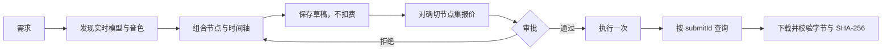

# Dreamina Canvas

## 插件市场导航

本插件所属分类：**AIGC 内容创作**。

| 分类 | 插件市场入口 | 用途 |
| --- | --- | --- |
| 全栈开发 | [Full Stack Plugins](https://github.com/partme-ai/full-stack-plugins) | 架构与 UI 设计、代码理解、质量检查、代码审查、流程治理与服务器运维 |
| AIGC 内容创作 | [Full AIGC Plugins](https://github.com/partme-ai/full-aigc-plugins) | 图像、视频、音频、音乐、3D 与多模态内容创作 |


> 用类型化节点与时间轴搭建即梦画布，把免费保存与报价运行严格分开，下载素材时附带字节数与 SHA-256 回执。

[](https://github.com/full-aigc-plugins/dreamina-canvas-plugin/releases) [](#技能) [](LICENSE)

[English](README.md) | [简体中文](README.zh-CN.md) · [安装](#安装) · [快速开始](#快速开始) · [技能](#技能) · [架构文档](docs/Dreamina-Canvas-Plugin-Architecture.zh_CN.md) · [故障排查](#故障排查)

## 项目定位

`dreamina-canvas` 把一段需求变成结构化即梦画布：类型化节点、时间轴、运行时能力发现、免费草稿保存，然后在费用报价之后、由你批准才执行一次。插件不硬编码目录取值，不把保存与运行合成一步，也不会为恢复超时另造一个 `submitId`。

它是已安装 `dreamina-canvas` CLI 的严格包装，不提供 MCP server：十一个技能通过仅接受 argv 的适配器驱动 CLI。鉴权与画布状态留在 CLI，插件只持久化非密钥的操作标识。

此前的[真实环境验收](docs/verification/real-environment-acceptance-2026-09-13.md)对所列 CLI 流程记录了 PASS；当前 Windows 与付费视觉闭环未重新验收。[add-canvas-visual-quality-loop 变更](openspec/changes/archive/2026-09-22-add-canvas-visual-quality-loop/proposal.md)记录单轮本地回归与尚未完成的多轮范围。

## 安装

### 前置条件

- `PATH` 上有 Python 3.11 或更新版本。
- 首次使用前已安装并完成登录的 `dreamina-canvas` CLI。安装与鉴权技能可以执行官方安装和登录，但必须先取得明确授权；插件不捆绑该二进制。
- 视觉循环运行时依赖：`requirements.txt` 中的 `jsonschema`，用 `python -m pip install -r requirements.txt` 安装。
- 开发与测试门禁另需 `requirements-dev.txt`。

### 从插件市场安装

```bash
codex plugin marketplace add partme-ai/full-aigc-plugins
codex plugin add dreamina-canvas@full-aigc-plugins
```

重启宿主并新建任务，让技能完成加载；随后校验随包技能与上游锁文件是否一致：

```bash
python scripts/verify_dreamina_canvas_skills.py
```

## 快速开始



```text
为一条 15 秒产品预告片创建即梦画布，先把节点草稿搭好，暂时不要运行任何东西。
```

预期现象：实时能力被发现，类型化节点被组合，草稿已保存，插件确认没有产生任何扣费。接着要求报价；在你批准积分总额之后，运行只发生一次。

## 可完成的工作

| 工作流 | 内置路径 | 可验证输出 |
| --- | --- | --- |
| 图像节点 | `dreamina-canvas-cli-text2image`、`dreamina-canvas-cli-image2image` | 已保存草稿、报价运行、校验过的图像素材 |
| 视频节点 | `dreamina-canvas-cli-text2video`、`dreamina-canvas-cli-ref2video` | 首尾帧或参考素材驱动的视频素材 |
| 音频节点 | `dreamina-canvas-cli-text2voice`、`dreamina-canvas-cli-text2audio` | 选定音色的旁白或音乐素材 |
| 画布编排 | `dreamina-canvas-cli`、`/dreamina-canvas-compose`、`/dreamina-canvas-timeline` | 节点图、时间轴轨道、替换的剪辑与音轨 |
| 运行与恢复 | `dreamina-canvas-cli-auth`、`/dreamina-canvas-run`、`/dreamina-canvas-resume` | 审批记录、报价、账本条目与恢复后的操作 |

## 技能

| 技能 | 作用 |
| --- | --- |
| `dreamina-canvas-cli` | 公共画布操作：模型与音色发现、画布与素材管理、节点编辑、时间轴、报价运行、状态恢复与下载校验。 |
| `dreamina-canvas-cli-setup` | 安装、升级或验证 CLI，含 PATH 排障。 |
| `dreamina-canvas-cli-auth` | 登录、设备授权、账户检查、凭据刷新与退出。 |
| `dreamina-canvas-cli-text2image` | 文生图模式：输入、参数校验、草稿与场景验收。 |
| `dreamina-canvas-cli-image2image` | 图生图与图片放大模式。 |
| `dreamina-canvas-cli-text2video` | 文生视频模式。 |
| `dreamina-canvas-cli-ref2video` | 参考素材视频，含 `m2v` 与首尾帧模式。 |
| `dreamina-canvas-cli-text2voice` | 文本转语音模式。 |
| `dreamina-canvas-cli-text2audio` | 音乐生成模式。 |
| `dreamina-canvas-harness` | 审批、单轮视觉评估、恢复与交付证据的路由与控制器边界。 |
| `dreamina-canvas-use` | 把未指定入口的图像、视频、语音或音乐请求路由到合适技能。 |

## 斜杠命令

| 命令 | 作用 |
| --- | --- |
| `/dreamina-canvas` | 总入口：路由建画布、组节点与生成。 |
| `/dreamina-canvas-setup` | 安装、升级或验证 CLI，含 PATH 排障。 |
| `/dreamina-canvas-auth` | 检查、刷新或恢复登录态。 |
| `/dreamina-canvas-create` | 创建或切换画布，确认 `projectId`。 |
| `/dreamina-canvas-image` | 文生图：草稿、批准运行、校验产物。 |
| `/dreamina-canvas-image2image` | 图生图与图片放大。 |
| `/dreamina-canvas-video` | 文生视频：草稿、批准运行、校验产物。 |
| `/dreamina-canvas-ref2video` | 参考素材或首尾帧视频。 |
| `/dreamina-canvas-audio` | 用选定音色做文本转语音。 |
| `/dreamina-canvas-music` | 按风格与时长生成音乐。 |
| `/dreamina-canvas-assets` | 上传素材、查询状态并放到画布上。 |
| `/dreamina-canvas-compose` | 按依赖顺序组合文本、元素与生成节点。 |
| `/dreamina-canvas-timeline` | 编排轨道、替换剪辑与音轨。 |
| `/dreamina-canvas-run` | 对已保存节点报价、取得积分批准并提交一次。 |
| `/dreamina-canvas-resume` | 查询、等待或恢复已提交的操作。 |

## 配置

本仓库没有插件配置文件，也不保存凭据。行为只由 CLI 参数与你明确的批准决定。

| 设置 | 位置 | 说明 |
| --- | --- | --- |
| CLI 可执行文件 | `PATH` 上的 `dreamina-canvas` | 受控部署可通过适配器覆盖 |
| 鉴权 | CLI 自己的存储 | 插件既不读取也不写入 |
| 操作账本 | `<root>/operations/<profile-and-environment>/<submitId>.json` | 权限 `0600`，只含非密钥字段 |
| 积分上限 | 随批准一并给出 | 低于最新权威总额的上限会被拒绝 |

## 架构与安全

`dreamina-canvas-plugin` 负责适配器、审批守卫、操作账本与产物校验；CLI 负责登录与远端状态，即梦负责画布服务，作者不接收任何素材。

- 保存与运行是两步操作；没有报价就无法批准。
- 批准绑定到报价的节点集与其工程，已消费的批准会被当作重放拒绝。
- 超时按既有 `submitId` 恢复；账本缺失时上交人工判断，而不是重试。
- 只持久化非密钥标识，凭据类字段名在落盘前就被拒绝。

| 证据 | 状态 |
| --- | --- |
| 离线、单元与场景门禁 | 当前本地回归记录见 `docs/verification/round-safety-2026-10-08.md` |
| 视觉单轮控制器 | 目标上传与 1 积分付费金丝雀记录来自 2026-09-22 的控制器 |
| 0.5.0 的实时、付费与 Windows 复跑 | 本 README 不作声明，以 `docs/verification/` 中带日期的记录为准 |

## 故障排查

| 现象 | 先检查 | 处理 |
| --- | --- | --- |
| 技能缺失 | 插件状态 | 重启宿主并新建任务 |
| 找不到 CLI | `PATH` 上的 `dreamina-canvas` | 运行 `/dreamina-canvas-setup` 并批准安装，或手动安装 |
| 运行停在审批 | 待处理的报价 | 核对积分总额后批准或拒绝 |
| 运行超时 | 账本条目 | 按既有 `submitId` 恢复，不要盲目重新报价 |
| 下载校验失败 | 回执 | 重新下载；字节数或摘要不一致即硬失败 |
| 需要登录 | CLI 会话 | 用 CLI 完成鉴权后重试 |

## 升级

```bash
codex plugin marketplace upgrade full-aigc-plugins
codex plugin add dreamina-canvas@full-aigc-plugins
```

升级后重新运行 `python scripts/verify_dreamina_canvas_skills.py`：随包技能钉在上游快照上，账本格式也是版本化的。

当前打包版本：`0.5.1+codex.20261018`（开发预览）。

## 贡献与支持

功能问题请提交到 <https://github.com/full-aigc-plugins/dreamina-canvas-plugin/issues>。先阅读 [CONTRIBUTING.md](CONTRIBUTING.md) 与 [SECURITY.md](SECURITY.md)，并说明你验证所用的 CLI 版本、改动是否触及审批绑定或账本格式，附上受影响的测试。

## 许可证

Apache-2.0，详见 [LICENSE](LICENSE)、[NOTICE](NOTICE) 与 [THIRD_PARTY_NOTICES.md](THIRD_PARTY_NOTICES.md)。
